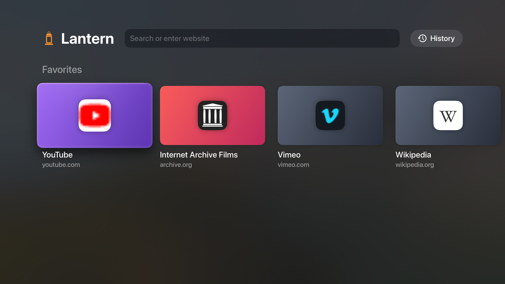
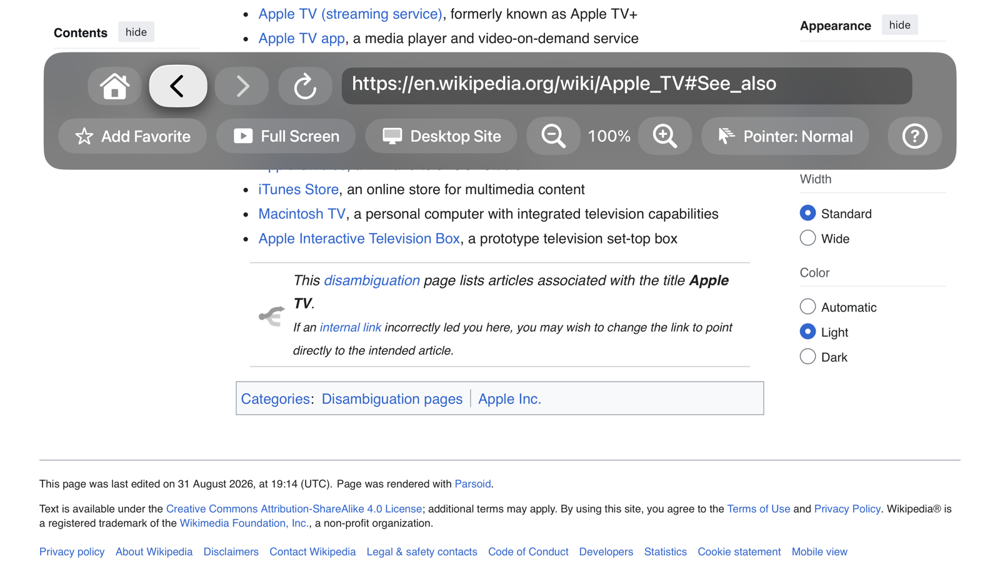

# Lantern

A web browser for Apple TV, built to be used from the couch with the Siri Remote.

tvOS ships Safari's web engine but doesn't let apps use it. Lantern loads it anyway and builds a TV-first browser around it: a pointer you steer with the clickpad, a home screen of your sites, and full-screen video in Apple's own player.

## Features

- **Pointer for the Siri Remote.** Swipe to move a smooth, steady pointer. A tvOS-style outline shows what a click will select, and clicks land on the nearest link or button, so you don't need pinpoint aim. Choose Slow, Normal or Fast pointer speed.
- **Full-screen video in Apple's player.** Hold Play/Pause (or use a site's own full-screen button) and the video opens in AVKit's player: true full screen, audio in sync, click to pause, swipe to scrub.
- **Works with embedded players.** Clicks, typing and full screen reach video players inside frames from other sites.
- **Typing.** Clicking a text field opens the tvOS keyboard, so typing from your iPhone and dictation work as usual.
- **Pop-up and ad blocking.** Windows opened by scripts are blocked, and requests to common ad and pop-under networks are blocked by WebKit content rules, including redirects that try to jump to an ad page.
- **Home screen.** Favorites, recently visited sites with page snapshots, a Continue tile, and full history.
- **Per-site settings.** Each site remembers its zoom and whether to show the desktop or mobile version. YouTube defaults to mobile, whose video the TV can play.
- **Stays responsive.** Lantern never queues work onto a slow page. If a page freezes, Back, Home and Reload shut it down and carry on.

## Using it

| Remote | What it does |
| --- | --- |
| Swipe | Move the pointer; push past the top or bottom edge to scroll |
| Click | Select what's outlined |
| Hold the click | Open the menu: address bar, back/forward, favorite, full screen, site version, zoom, pointer speed |
| Click the top or bottom of the clickpad | Scroll half a screen |
| Back | Previous page, then Lantern's home; on the home screen, press twice to leave |
| Play/Pause | Play or pause the page's video |
| Hold Play/Pause | Full screen |

## Building

Requirements: Xcode 26 or later, and an Apple TV on tvOS 26 or later paired with your Mac.

1. Open `Lantern.xcodeproj`.
2. In the Lantern target's Signing & Capabilities, choose your own team and a unique bundle identifier.
3. Choose your Apple TV as the run destination and press Run.

With a free Apple developer account, apps you install yourself stop opening after 7 days; run it from Xcode again to renew.

## How it works

- `TV/Engine/LanternWebView` loads WebKit at runtime and hosts a `WKWebView` through the Objective-C runtime. It's the only place that touches the engine.
- `TV/Engine/lantern-isolated.js` runs in a private script world in every frame. It turns pointer positions into mouse events and clicks, finds what's clickable near the pointer, handles text fields and lists, and hands videos to the native player. Frames talk to each other with `postMessage` and a per-launch token.
- `TV/Engine/lantern-page.js` runs in the page's own world and turns the page's fullscreen requests into Lantern's full screen.
- `TV/Browser` holds the browser screen, the pointer, the menu and the native player; `TV/Home` holds the home screen.

The web engine on tvOS doesn't include Media Source Extensions, so videos that sites feed to the page in pieces won't play. Videos with a normal or HLS stream address do, which is what most sites send to iPhones.

## Notes

Lantern uses APIs Apple doesn't publish, so it can't go on the App Store and a future tvOS update could break it. It's meant for building and installing on your own Apple TV.

The idea of loading WebKit on tvOS at runtime comes from [tvOSBrowser](https://github.com/jvanakker/tvOSBrowser), originally by Steven Troughton-Smith. Lantern is a separate implementation and shares no code with it.
